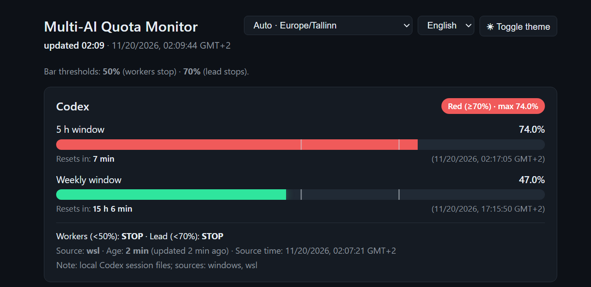
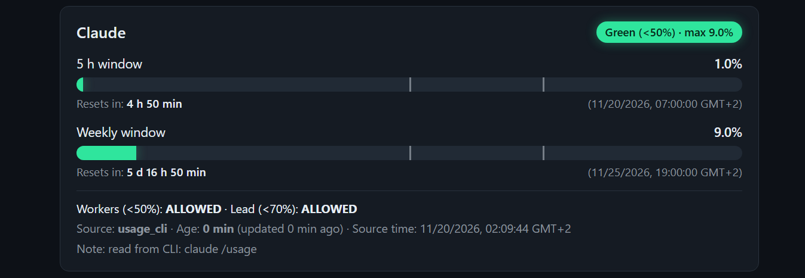
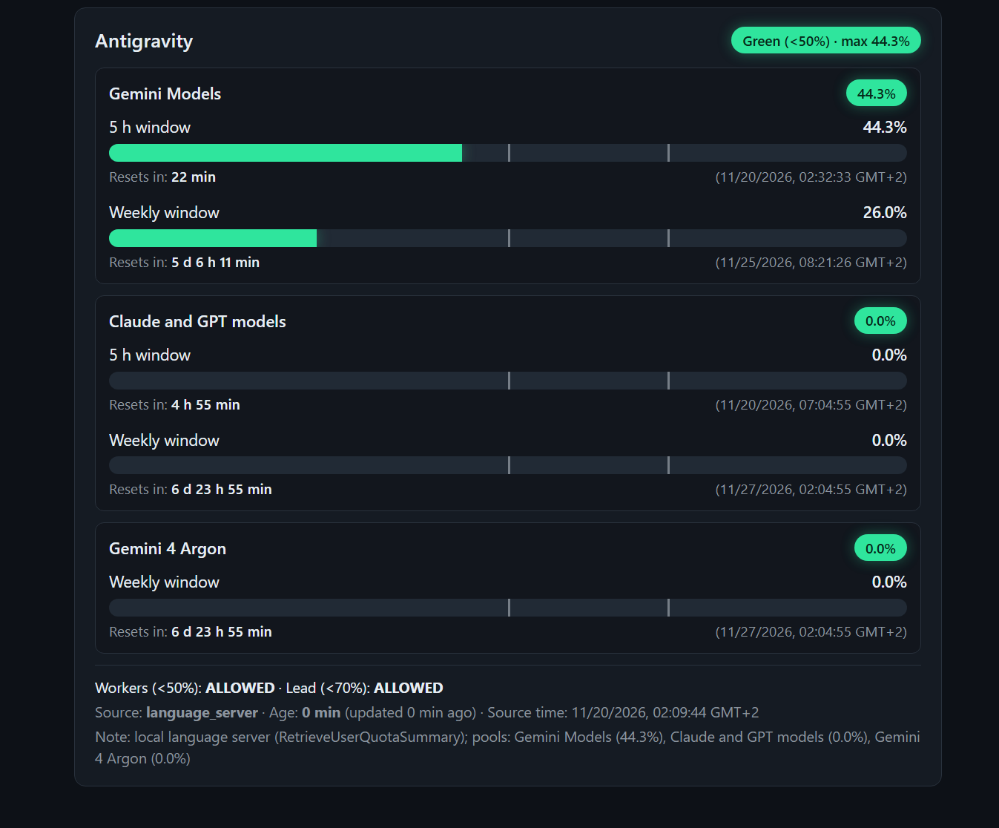

# Mitme AI kvoodimõõdik (`kvoodimootur`)

_[In English](README.md)_

Pythoni standardteegil põhinev tööriist, mis annab ühe vaate mitme AI-pakkuja (**Codex**, **Claude Code**, **Antigravity**) kohalikele kvoodiseisudele (5 h ja nädala aken), kirjutab masinloetava `kvoot.json` (`schema: "kvoot/4"`), genereerib staatilise `kvoot.html` vaate (tume/hele teema, keelelüliti ja ajavööndi valik) ning pakub automaatikale väljumiskoode (`0` / `1` / `2` / `3`).

**Nõuded:** Python 3.10+ (ainult standardteek). Node.js on vajalik ainult HTML/JS-testi jaoks, mis ilma `node`-ita jääb automaatselt vahele.

## Kuvatõmmis

Üks leht, iga kvoodiakna kohta üks riba. 50 % piir peatab automaatsed töölised, 70 % piir juhtagendid.





## Kiirstart

1. Laadi see repositoorium alla või klooni (`git clone https://github.com/TCalvion/multi-ai-quota-monitor.git`).
2. Ava kaust (`cd multi-ai-quota-monitor`).
3. Käivita Windowsis `py -3 kvoot.py` või Linuxis/macOS-is `python3 kvoot.py` (lisa `--all`, kui soovid värskendada ka `claude /usage`).
4. Ava tekkinud `kvoot.html` brauseris (või lisa käivitusel `--open`).

## Allikad

1. **Codex**
   - Skaneerib viimase N päeva (`KVOOT_CODEX_DAYS`, vaikimisi `3`) `rollout-*.jsonl` sessioonifaile Windowsis ja WSL-is.
   - **Privaatsus:** loeb ainult `rate_limits`-välju; vestluste sisu ei parsita, ei salvestata ega logita.
2. **Claude Code**
   - Võrdleb kolme kohalikku sisendit värskeima ajatempli järgi:
     - `usage_cli`: `kvoot_claude_usage.json`, mis saadakse `claude /usage` käivitamisel tühjas proovikaustas (`~/.kvoot-probe`) pseudoterminalis (`CLAUDE_CODE_OAUTH_TOKEN` eemaldatud). Esimesel käivitusel küsib Claude Code selle proovikausta usaldamist ning tööriist vastab automaatselt „jah“.
     - `statusline`: `kvoot_claude.json`, mille salvestab `claude_statusline.py`.
     - `manual`: `kvoot_claude_manual.json`, mis salvestatakse käsuga `--set claude`.
   - Kui värskeimas allikas puudub üks aken, võetakse see värskest varuallikast; kui varuallikat pole, jääb seisuks `unknown` (väravas `null`).
3. **Antigravity**
   - Küsib töötavalt kohalikult keeleserverilt aadressil `127.0.0.1` (proxy ja HTTP-suunamised on keelatud).
   - Loeb `--csrf_token` väärtuse ainult mällu; tokenit ega porti ei kirjutata faili, logisse ega veateatesse.
   - Kuvab alamkogumid (`pools`, nt Gemini, Claude & GPT, Argon) ja hindab piire nende `max` väärtuse järgi.
   - Kui keeleserver ei tööta, loeb viimase teadaoleva näidu failist `~/.kvoot/kvoot_antigravity_last.json` (üleminekul loeb ka vana `~/.tc-kvoot/kvoot_antigravity_viimane.json` faili).

## Kasutamine

```bash
# Kõigi kolme allika värske lugemine paralleelselt
python3 kvoot.py --all

# Kõik allikad + ava kvoot.html vaikebrauseris
python3 kvoot.py --all --open

# Kiire lugemine (olemasolevad failid + töötav Antigravity keeleserver)
python3 kvoot.py

# Rollikontroll automaatikale (väljumiskoodid 0, 1, 2, 3)
python3 kvoot.py --check worker --source codex
python3 kvoot.py --check lead --source claude
python3 kvoot.py --check worker --source antigravity

# Käsitsi sisestus (varuallikas)
python3 kvoot.py --set claude --5h 40 --7d 62
python3 kvoot.py --set claude --5h 40 --7d 62 --5h-reset 14:30 --7d-reset 2026-11-20T15:00:00+02:00
```

Eestikeelsed lipud jäävad aliastena alles: `--kontroll` (`tooline|juht`), `--allikas`, `--koik`, `--ava`, `--sisesta`, `--7p`, `--5h-lahtestub`, `--7p-lahtestub`.

### Windowsi töölaua ikoon

- `kvoot_ava.pyw` käivitab `kvoot.py --all --open` ilma konsooliaknata.
- `paigalda_ikoon.ps1` loob töölaua otsetee (`Kvoot.lnk`). Käivita see kohalikust Windowsi kaustast (nt `C:\...`), mitte WSL-i ega võrgu UNC-teelt (`\\wsl.localhost\...`, `\\wsl$\...`, `\\...`).

### `--check` väljumiskoodid

- `0` — **LUBATUD**: näit on värske ja alla rolli piiri (vaikimisi `< 50%` tööline, `< 70%` juht).
- `1` — **KEELATUD**: näit on värske ja vähemalt rolli piiril.
- `2` — **TEADMATA (puudub)**: allikas puudub või on tundmatu.
- `3` — **TEADMATA (vana / puudulik)**: näit on vanem kui `stale_minutes` (vaikimisi `180` min) või aken puudub.

## Seadistus

Prioriteet: **keskkonnamuutuja > `<skripti_kaust>/kvoot.config.json` > vaikeväärtus**. Windowsi keskkonnamuutujad ei jõua WSL-i alamprotsessidesse, skripti kaustas olev `kvoot.config.json` jõuab. Windowsis tasub määrata `timezone` failis `kvoot.config.json` (nt `"Europe/Tallinn"`).

- `KVOOT_LANG` (`lang`): keel (`en`, `et`, `fi`, ...; vaikimisi süsteemi keel → `en`; ka `--lang <kood>`).
- `KVOOT_TZ` (`timezone`): ajavöönd (vaikimisi süsteemi kohalik ajavöönd; keskkonnamuutuja `TZ` toetab ka POSIX-reegleid; kättesaamatu või parsimatu `KVOOT_TZ` / `timezone` / `TZ` annab märkuse `timezone_unavailable` ja kasutab UTC-d). Sisseehitatud POSIX `TZ` parser järgib POSIX-reeglit ise ega sõltu Windowsi CRT tõlgendusest (Windowsi CRT kasutab suveaja jaoks USA reegleid), mistõttu võib süsteemi kell erineda.
- `KVOOT_TITLE` (`title`): HTML-i ja veateadete pealkiri (vaikimisi tõlgitud „Mitme AI kvoodimõõdik“ / „Multi-AI Quota Monitor“).
- `KVOOT_WORKER_LIMIT` (`worker_limit`): tööliste piir % (vaikimisi `50.0`).
- `KVOOT_LEAD_LIMIT` (`lead_limit`): juhi piir % (vaikimisi `70.0`).
- `KVOOT_STALE_MIN` / `KVOOT_VANA_MIN` (`stale_minutes`): vananemispiir minutites (vaikimisi `180`).
- `KVOOT_CODEX_DAYS` (`codex_days`): Codexi kaustade päevade aken (vaikimisi `3`).
- `KVOOT_STATE_DIR` (`state_dir`): olekukaust (vaikimisi `~/.kvoot`, loeb vajadusel vanast `~/.tc-kvoot`-st).
- `KVOOT_KODU`, `KVOOT_WIN_HOME`, `KVOOT_CODEX_DIRS`, `KVOOT_CONFIG`.

## Uue keele lisamine

Koodi ei ole vaja muuta:
1. Kopeeri `lang/en.json` failiks `lang/<kood>.json` (nt `lang/de.json`).
2. Määra `"_lang_name"` keele nimeks ja tõlgi väärtused (jäta `{muutujad}` alles).
3. Puuduv võti langeb automaatselt inglise keelele; uus keel ilmub kohe `kvoot.html` keelelüliti menüüsse.

## Teadaolevad piirid

- **Antigravity:** kasutab dokumenteerimata kohaliku keeleserveri liidest (`RetrieveUserQuotaSummary` jt), mis võib IDE uuendusega muutuda või katki minna.
- **Claude `/usage`:** parsib terminali tekstiekraani; kui ekraani vorming muutub, tagastab parser vea või puuduva akna (`unknown`, kood `3`), mitte oletatud numbri.
- **Windows ↔ WSL:** `claude /usage` eeldab POSIX PTY-d (Windowsis käivitatakse üle `wsl.exe`).

Detailne `kvoot/4` skeemi kaardistus ning `note_code`/`reason_code` koodide loetelu on failis [README.md](README.md).
