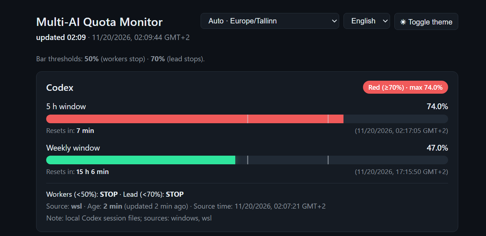
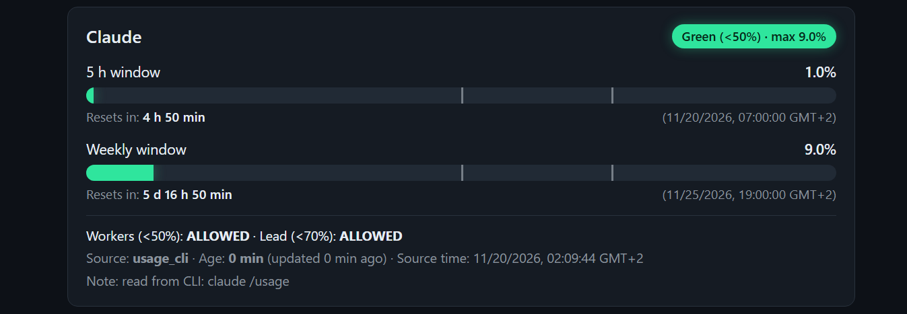
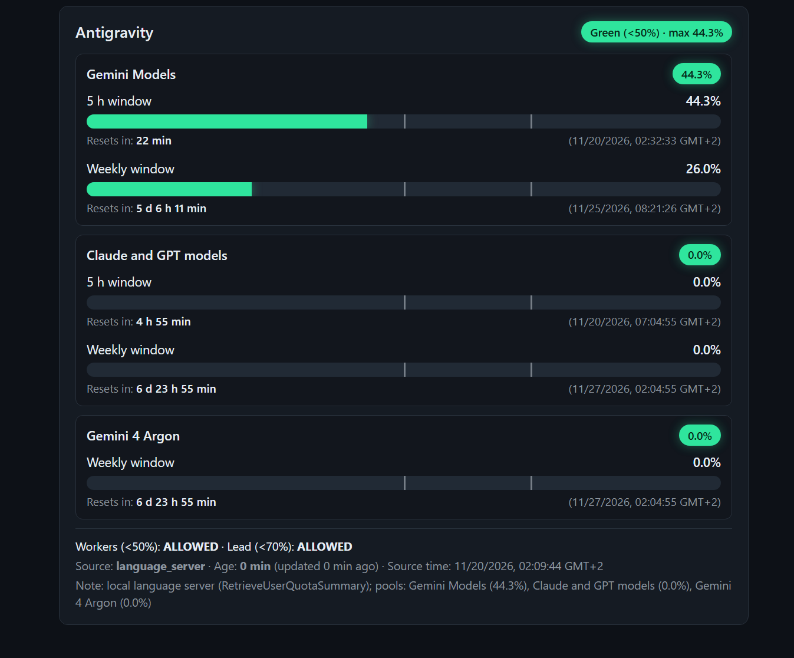

# Multi-AI Quota Monitor (`kvoodimootur`)

_[Eesti keeles / Estonian](README.et.md)_

One view for several AI providers' quotas: a lightweight Python standard-library tool that reads local usage quotas (5-hour and weekly windows) across **Codex**, **Claude Code**, and **Antigravity** providers, writes machine-readable `kvoot.json` (`schema: "kvoot/4"`), renders a self-contained static dashboard `kvoot.html` (with dark/light theme, live language switcher, and timezone selector), and provides exit-code gating (`0` / `1` / `2` / `3`) for automation scripts.

**Requirements:** Python 3.10+ (standard library only). Node.js is optional and only needed to run the HTML/JS unit test (which is skipped automatically if `node` is not installed).

## Screenshot

One page, one bar per quota window. The 50 % mark stops automated workers, the 70 % mark stops lead agents.





## Quickstart

1. Download or clone this repository (`git clone https://github.com/TCalvion/multi-ai-quota-monitor.git`).
2. Open the folder (`cd multi-ai-quota-monitor`).
3. Run `py -3 kvoot.py` on Windows or `python3 kvoot.py` on Linux/macOS (add `--all` to also probe `claude /usage`).
4. Open the generated `kvoot.html` in your browser (or pass `--open`).

## Sources

1. **Codex**
   - Scans local `rollout-*.jsonl` session files from the last N days (`KVOOT_CODEX_DAYS`, default `3`) across Windows and WSL.
   - **Privacy:** reads `rate_limits` fields exclusively; chat messages and prompts are never parsed, stored, or logged.
2. **Claude Code**
   - Selects the freshest reading across three local inputs:
     - `usage_cli`: `kvoot_claude_usage.json` produced by running `claude /usage` inside an empty probe directory (`~/.kvoot-probe`) via PTY with `CLAUDE_CODE_OAUTH_TOKEN` removed from the subprocess environment. On first run, Claude Code asks whether to trust that probe directory and the tool automatically answers "Yes".
     - `statusline`: `kvoot_claude.json` written by `claude_statusline.py` when hooked into Claude Code's `statusLine`.
     - `manual`: `kvoot_claude_manual.json` written via `--set claude`.
   - If the freshest source is missing one window (e.g., 5h or weekly), the missing window is filled from a fresher-than-stale fallback source if available; otherwise the source status becomes `unknown` (`null` gate).
3. **Antigravity**
   - Queries a running local Antigravity language server process at `127.0.0.1` (disabling proxies and HTTP redirects).
   - Reads `--csrf_token` from process command line into memory only; never writes the token or local port into cache files, JSON output, logs, or error messages.
   - Reports per-pool usage (`pools`, e.g., Gemini, Claude & GPT, Argon) and evaluates the maximum across pools.
   - If the language server is not running, falls back to the last-known cache in `~/.kvoot/kvoot_antigravity_last.json` (also reading legacy `.tc-kvoot/kvoot_antigravity_viimane.json` during migration).

## Usage

```bash
# Query all three sources freshly in parallel and write kvoot.json + kvoot.html
python3 kvoot.py --all

# Query all sources and open kvoot.html in the default browser
python3 kvoot.py --all --open

# Quick read (existing local files + running Antigravity language server; skips claude /usage)
python3 kvoot.py

# Role check for automation gates (exit codes 0, 1, 2, 3)
python3 kvoot.py --check worker --source codex
python3 kvoot.py --check lead --source claude
python3 kvoot.py --check worker --source antigravity

# Manual Claude quota entry (fallback)
python3 kvoot.py --set claude --5h 40 --7d 62
python3 kvoot.py --set claude --5h 40 --7d 62 --5h-reset 14:30 --7d-reset 2026-11-20T15:00:00+02:00
```

Estonian CLI aliases are also supported for backward compatibility:
- `--check` / `--kontroll` (`worker|lead` / `tooline|juht`)
- `--source` / `--allikas`
- `--all` / `--koik`
- `--open` / `--ava`
- `--set` / `--sisesta`
- `--7d` / `--7p`
- `--5h-reset` / `--5h-lahtestub`
- `--7d-reset` / `--7p-lahtestub`

### Exit Codes (`--check`)

- `0` — **ALLOWED**: reading is fresh and strictly below the role limit (`< 50%` worker, `< 70%` lead by default).
- `1` — **DENIED**: reading is fresh and at or above the role limit.
- `2` — **UNKNOWN (missing)**: source is unavailable or unknown.
- `3` — **UNKNOWN (stale / incomplete)**: reading is older than `stale_minutes` (default `180`) or missing a required window.

### Windows Desktop Shortcut

- `kvoot_ava.pyw` runs `kvoot.py --all --open` without a console window.
- `paigalda_ikoon.ps1` creates a desktop shortcut (`Kvoot.lnk`) using `kvoot.ico`. Run it from a local Windows folder (e.g. `C:\...`), not from a WSL/network UNC path (`\\wsl.localhost\...`, `\\wsl$\...`, `\\...`).

## Configuration

Settings resolve in order: **environment variable > `<script_dir>/kvoot.config.json` > default**.

- Default `kvoot.config.json` is read from the script directory (`<script_dir>/kvoot.config.json`), not the current working directory.
- `KVOOT_CONFIG` is an explicit override: if set and that file does not exist, `config_not_found` is reported instead of falling back to `<script_dir>/kvoot.config.json`. If a config file exists (explicit or `<script_dir>/kvoot.config.json`) and cannot be parsed as a JSON object, `config_invalid` is reported.
- Windows environment variables do not automatically propagate into WSL subprocesses (`claude /usage`, Antigravity WSL fallback), whereas `<script_dir>/kvoot.config.json` does.
- Windows: set `timezone` in `kvoot.config.json` (e.g. `"Europe/Tallinn"` or `"UTC"`); without `tzdata`, Windows Python has no built-in IANA database and system time uses a fixed offset without DST.

| Environment variable | `kvoot.config.json` key | Default | Description |
|---|---|---|---|
| `KVOOT_LANG` | `lang` | System language → `en` | UI and message language (`en`, `et`, `fi`, ...; also `--lang <code>`) |
| `KVOOT_TZ` | `timezone` | System local timezone | IANA timezone (e.g. `Europe/Tallinn`, `UTC`); environment `TZ` also supports POSIX TZ rules |
| `KVOOT_TITLE` | `title` | Localized `"Multi-AI Quota Monitor"` | Dashboard HTML and desktop dialog title |
| `KVOOT_WORKER_LIMIT` | `worker_limit` | `50.0` | Worker threshold percentage |
| `KVOOT_LEAD_LIMIT` | `lead_limit` | `70.0` | Lead threshold percentage |
| `KVOOT_STALE_MIN` (`KVOOT_VANA_MIN`) | `stale_minutes` | `180` | Age in minutes after which a reading is `stale` |
| `KVOOT_CODEX_DAYS` | `codex_days` | `3` | Days of Codex session folders to scan |
| `KVOOT_STATE_DIR` | `state_dir` | `~/.kvoot` | Directory for state/cache files (reads legacy `~/.tc-kvoot` if `~/.kvoot` does not exist yet) |
| `KVOOT_KODU` | — | Auto-detected home | Overrides base home directory |
| `KVOOT_WIN_HOME` | — | Auto-detected via `cmd.exe`/`wslpath` | Overrides Windows profile path when running in WSL |
| `KVOOT_CODEX_DIRS` | — | Auto-discovered | Semicolon-separated Codex session paths (optional `windows=`/`wsl=` prefix) |
| `KVOOT_CONFIG` | — | `<script_dir>/kvoot.config.json` | Override path to JSON config file (`config_not_found` if missing, `config_invalid` if malformed) |

## `kvoot.json` Contract (`kvoot/4`)

```json
{
  "schema": "kvoot/4",
  "read_at": "2026-11-18T10:00:00+02:00",
  "limits": {
    "worker": 50.0,
    "lead": 70.0
  },
  "sources": {
    "codex": {
      "available": true,
      "source_time": "2026-11-18T09:55:00+02:00",
      "source_location": "wsl",
      "age_min": 5,
      "window_5h": { "used": 24.0, "resets_at": "2026-11-18T14:00:00+02:00", "reset": false },
      "window_weekly": { "used": 11.0, "resets_at": "2026-11-23T09:00:00+02:00", "reset": false },
      "max": 24.0,
      "status": "green",
      "read_time_ms": 4.2,
      "note_code": "local_sessions",
      "note": "local Codex session files; sources: windows, wsl"
    }
  },
  "workers_allowed": { "codex": true, "claude": null, "antigravity": true },
  "lead_allowed": { "codex": true, "claude": null, "antigravity": true }
}
```

### Status Values

- `green` (`< worker_limit`)
- `yellow` (`worker_limit <= max < lead_limit`)
- `red` (`>= lead_limit`)
- `stale` (`age_min > stale_minutes`)
- `unknown` (e.g., incomplete windows)

### `note_code` Values (when `available: true` or top-level configuration note)

| Code | Meaning |
|---|---|
| `local_sessions` | Codex quota read from local session files |
| `partial_sources` | Codex quota read, but one or more configured paths were unavailable |
| `usage_cli` | Claude quota read from `claude /usage` |
| `statusline` | Claude quota read from `statusLine` hook file |
| `manual_entry` | Claude quota read from manual `--set claude` entry |
| `missing_window` | Primary Claude source lacked a window (filled from fallback or marked `unknown`) |
| `usage_probe_failed` | Fresh `claude /usage` failed; serving existing fallback file |
| `language_server` | Live reading from Antigravity local language server |
| `last_known_cache` | Antigravity server not running; serving last-known cached reading |
| `cache_write_failed` | Antigravity live reading succeeded, but saving the cache file failed |
| `win_home_ambiguous` | Multiple Windows user profiles with AI data found in WSL fallback; set `KVOOT_WIN_HOME` |
| `timezone_unavailable` | Configured `KVOOT_TZ` / `timezone` or environment `TZ` is unavailable in `zoneinfo` or cannot be parsed (fell back to UTC) |
| `timezone_windows_fixed` | Windows system timezone without configured `timezone` uses a fixed offset without DST |
| `limits_inverted` | Configured `worker_limit > lead_limit`; reverted to default limits (`50.0` / `70.0`) |
| `config_not_found` | Explicit `KVOOT_CONFIG` file path does not exist |
| `config_invalid` | Config file exists (`KVOOT_CONFIG` or `<script_dir>/kvoot.config.json`) but cannot be parsed as a JSON object |

### `reason_code` Values (when `available: false`)

| Code | Meaning |
|---|---|
| `codex_dir_not_found` | No Codex session directory found |
| `codex_no_session_files` | No `rollout-*.jsonl` files within `codex_days` |
| `codex_no_rate_limits` | Session files contained no valid `rate_limits` entry |
| `codex_missing_windows` | `rate_limits` entry had neither primary nor secondary window |
| `claude_file_not_found` | None of `usage_cli`, `statusline`, or `manual` files exist |
| `claude_probe_failed` | `claude /usage` probe failed and no fallback file exists |
| `folder_trust` | Claude CLI prompted for folder trust |
| `auth_required` | Claude CLI is not authenticated |
| `subscription_required` | `claude /usage` is unavailable for API billing plans |
| `rate_limited` | `claude /usage` hit a rate limit |
| `timeout` | `claude /usage` timed out or did not finish loading |
| `parse_failed` | Expected usage windows were not found on `claude /usage` screen |
| `cli_not_found` | `claude` CLI binary not found |
| `cli_exec_failed` | Failed to spawn `claude` CLI process |
| `pty_unsupported` | POSIX PTY is not supported on Windows |
| `wsl_exec_failed` | Failed to launch `wsl.exe` for `claude /usage` probe |
| `wsl_exit` | WSL `claude /usage` probe exited with non-zero code without output |
| `server_not_running` | Antigravity language server process not found |
| `no_listening_ports` | No listening TCP ports found for Antigravity language server |
| `server_no_response` | Antigravity language server did not return valid quota data |
| `parse_error` | Failed to parse Antigravity response |
| `no_quota_data` | Antigravity response contained no quota pools |
| `probe_error` | Unexpected exception in source reader |

### v3 → `kvoot/4` Key Mapping

| v3 key | `kvoot/4` key | Scope |
|---|---|---|
| *(new)* | `schema` (`"kvoot/4"`) | Top-level |
| `loetud` | `read_at` | Top-level |
| *(new)* | `limits` (`{"worker", "lead"}`) | Top-level |
| `allikad` | `sources` | Top-level |
| `toolised_lubatud` | `workers_allowed` | Top-level |
| `juht_lubatud` | `lead_allowed` | Top-level |
| `olemas` | `available` | Source |
| `allika_aeg` | `source_time` | Source |
| `allikas_koht` | `source_location` | Source (`local`, `manual`, `language_server`, `last_known`, `windows`, `wsl`, `usage_cli`, `statusline`) |
| `vanus_min` | `age_min` | Source / fallback window |
| `aken_5h` | `window_5h` | Source / pool |
| `aken_nadal` | `window_weekly` | Source / pool |
| `kogumid` | `pools` | Antigravity source |
| `seis` | `status` (`green`, `yellow`, `red`, `stale`, `unknown`) | Source / pool |
| `lugemise_aeg_ms` | `read_time_ms` | Source |
| `markus` | `note_code` + `note` | Source (`available: true`) |
| `pohjus` | `reason_code` + `reason` | Source (`available: false`) |
| `nimi` | `name` | Pool |
| `kasutatud` | `used` | Window |
| `lahtestub` | `resets_at` | Window |
| `lahtestunud` | `reset` | Window |
| `kirjutatud` | `written_at` | Cache files (`kvoot_claude*.json`, `kvoot_antigravity_last.json`) |

Legacy v3 cache files on disk are read automatically once and upgraded to `kvoot/4` keys on the next write.

## Adding a New Language

No Python or HTML code changes are needed to add a language:

1. Copy `lang/en.json` to `lang/<code>.json` (for example `lang/de.json`).
2. Set `"_lang_name"` to the display name (for example `"Deutsch"`) and translate the values.
3. Keep `{placeholders}` intact; any missing key automatically falls back to `lang/en.json`.
4. The new language immediately works via `KVOOT_LANG=<code>` and appears in the `kvoot.html` language menu.

## Known Limits

- **Antigravity:** relies on undocumented local language-server endpoints (`RetrieveUserQuotaSummary`, `GetUserStatus`, `GetCommandModelConfigs`) and process command-line flags (`--csrf_token`). An IDE update can change or break these at any time, in which case the monitor falls back to cache or reports `available: false` (`server_no_response` / `no_quota_data`).
- **Claude `/usage`:** parses the interactive terminal UI of `claude /usage`. If Claude Code changes its terminal layout or labels, the parser intentionally fails closed (`parse_failed` or `missing_window` → `unknown` / exit `3`) instead of guessing numbers.
- **Windows ↔ WSL:** `claude /usage` requires POSIX PTY (invoked via `wsl.exe` when running on Windows), and dynamic Windows profile detection from WSL assumes `cmd.exe` / `/mnt/c/Users` or `KVOOT_WIN_HOME`. When `cmd.exe` fails and multiple user profiles contain AI data, detection refuses to guess (`win_home_ambiguous`).
- **Timezones on Windows:** Windows Python does not include an IANA timezone database unless `tzdata` is installed. `UTC`, `Europe/Tallinn`, and valid POSIX `TZ` rules have built-in DST support; other IANA names (in `KVOOT_TZ`, `timezone`, or `TZ`) require `pip install tzdata` (otherwise `timezone_unavailable` is reported and UTC is used; unparseable `TZ` values also report `timezone_unavailable` and use UTC). The built-in POSIX `TZ` parser follows the POSIX rule directly rather than relying on the Windows CRT (which uses US DST rules), so its result can differ from the system C runtime clock. Without `timezone` or `TZ` configured, Windows system time uses a fixed offset without DST (in `kvoot.html`, the browser-side timezone selector handles DST automatically).
- **Tests:** `python3 -m unittest discover -s tests -v` runs synthetic unit tests on Python 3.10+ using standard-library `unittest` (no external Python dependencies) and passes on both Linux/WSL and Windows (2 POSIX PTY tests are skipped on Windows; the JS test requires `node` and is skipped if `node` is not installed).

## Attribution

Portions of `claude_usage.py` and `antigravity_probe.py` are adapted from [ClaudeBar](https://github.com/tddworks/ClaudeBar) under the Apache License, Version 2.0. See [LICENSE](LICENSE), [NOTICE](NOTICE), and [LICENSES/Apache-2.0.txt](LICENSES/Apache-2.0.txt).
